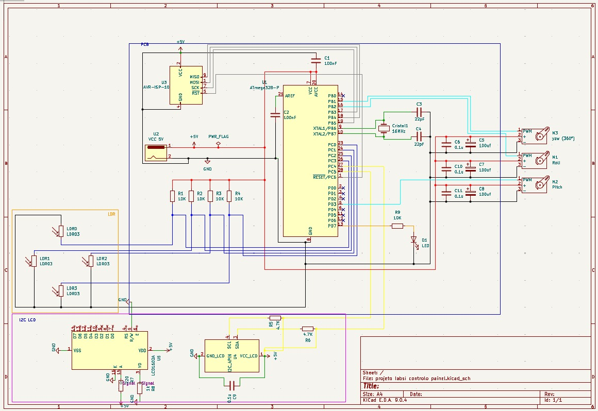
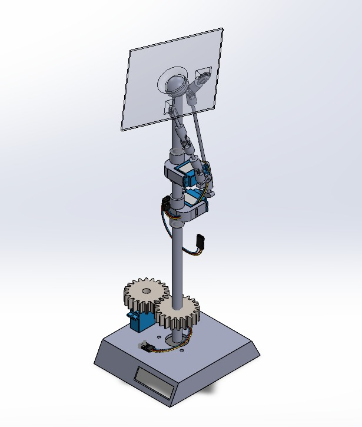
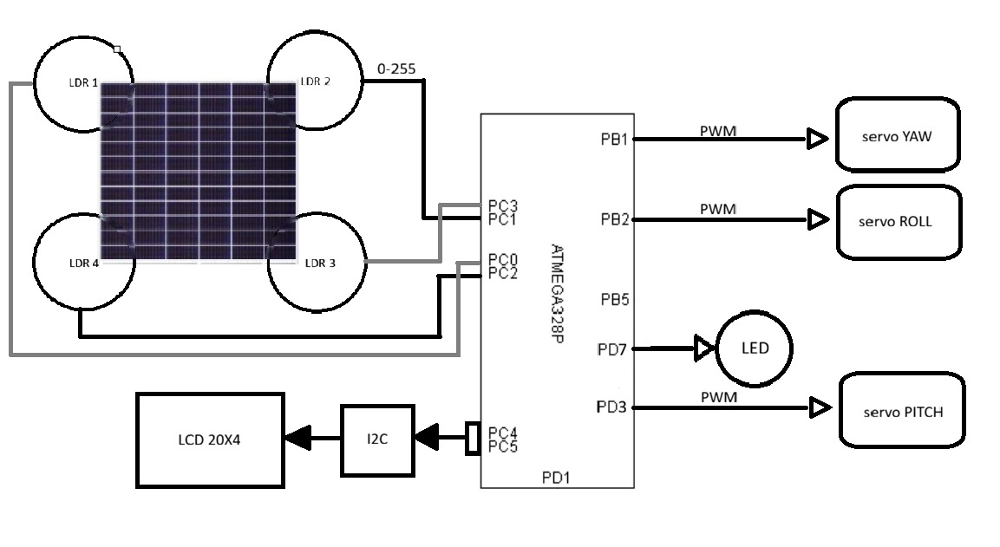
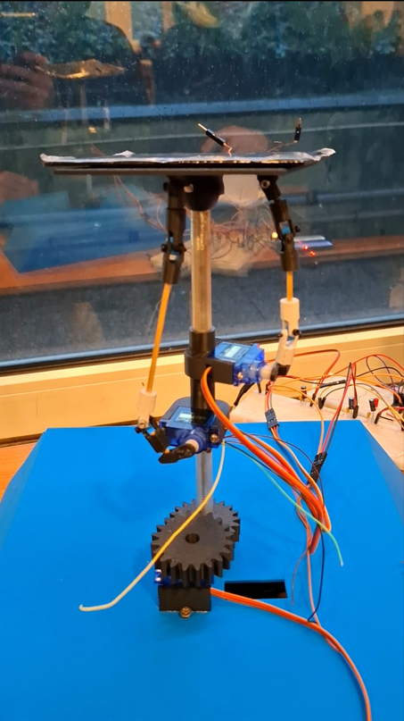
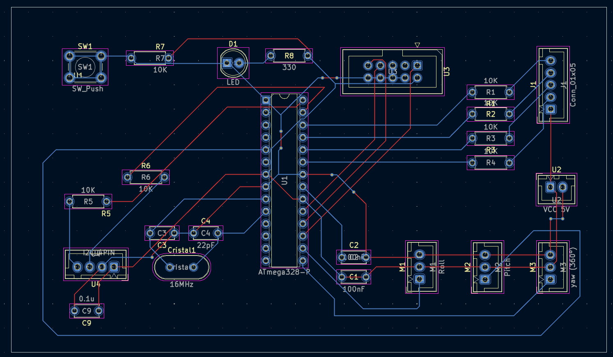
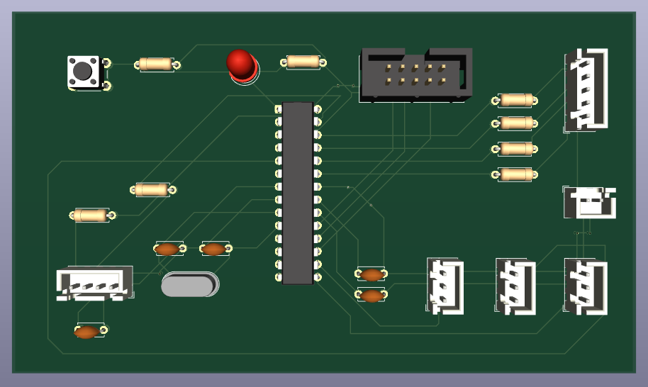

# Three-axis solar tracker with an ATmega328P

A small solar panel that turns to follow a light source. Four light sensors (LDRs) around the panel tell an ATmega328P where the light comes from, and the microcontroller moves three servos (yaw, pitch and roll) to keep the panel facing it. The firmware is written in C, directly on the registers, without Arduino libraries.

Course project for Systems Laboratory (LABSI), BSc in Electrical and Computer Engineering, ISEP – Polytechnic of Porto, 2025/2026.

 

Demo video, with the panel following a phone torch:


https://github.com/user-attachments/assets/edf8b6e1-a64c-4ee0-b876-53fe52c1370e


## How it works



The four LDRs are placed in a cross around the panel, each in a voltage divider with a 10 kΩ resistor, and read by the 10-bit ADC. Every 50 ms the firmware reads them and averages them in pairs: top against bottom, and left against right.

- **Pitch** follows the top–bottom difference and **roll** follows the left–right difference. A dead band stops the servos from shaking when the difference is small. Pitch moves in steps of 3° and roll in steps of 1°.
- **Yaw** is a continuous-rotation servo at the base. When pitch or roll reaches the end of its range, the base turns about 180° and that axis goes back near its centre, so the panel keeps tracking instead of getting stuck.
- When the pitch servo hits a limit, it stays there until the light moves back, so it does not keep pushing against the end stop.
- **Night mode:** when the average light falls below a threshold, the panel goes to a parking position. Tracking starts again when the light rises above the threshold plus a margin (hysteresis).
- A 20×4 LCD over I2C shows the four sensor readings, the average light and the pitch and roll angles. The firmware scans the I2C bus at start-up to find the LCD address.

### Timers

| Timer | Use |
|---|---|
| Timer0 | 1 ms interrupt, used as a `millis()` time base |
| Timer1 | Hardware PWM at 50 Hz for the yaw (PB1) and roll (PB2) servos |
| Timer2 | 20 µs interrupt that generates a software PWM signal for the pitch servo (PD3) |

## Hardware

- ATmega328P with a 16 MHz crystal, programmed through ISP with a USBasp
- 4 LDRs with 10 kΩ resistors
- 2 positional servos (pitch, roll) and 1 continuous-rotation servo (yaw)
- 20×4 LCD with an I2C adapter
- 5 V supply shared by all parts

A PCB was also designed for the circuit:

  

## Building and flashing

```
avr-gcc -mmcu=atmega328p -Os -Wall -o solar_tracker.elf solar_tracker.c
avr-objcopy -O ihex solar_tracker.elf solar_tracker.hex
avrdude -c usbasp -p m328p -U flash:w:solar_tracker.hex
```

The program uses about 2.4 KB of the 32 KB of flash. Servo limits, step sizes, the dead band and the night threshold are all defined at the top of `solar_tracker.c`, so they can be adjusted to a different mechanical build.

## Limitations

- The energy gain compared with a fixed panel was not measured.
- In night mode the base turn is repeated on every cycle while it stays dark. It should run only once when entering the mode.
- Calibration of the sensors and servos was done by hand. More time would allow a better control algorithm than fixed steps with a dead band, for example a proportional controller.

## Credits

Developed by Pedro Deveza Félix and Pedro Miguel Almeida for the Systems Laboratory course at ISEP, 2025/2026.
